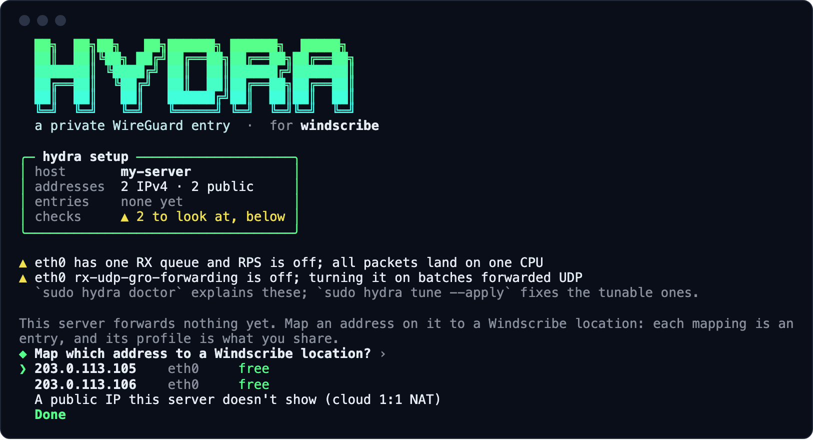
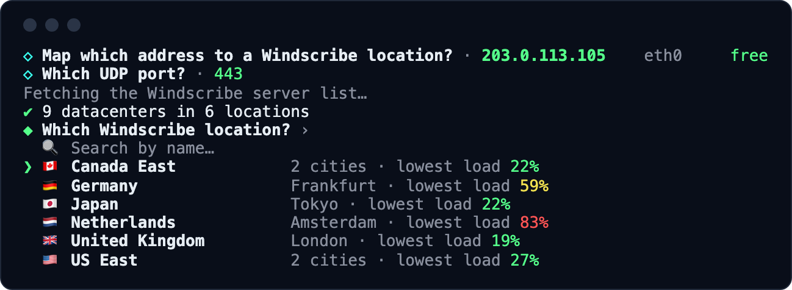
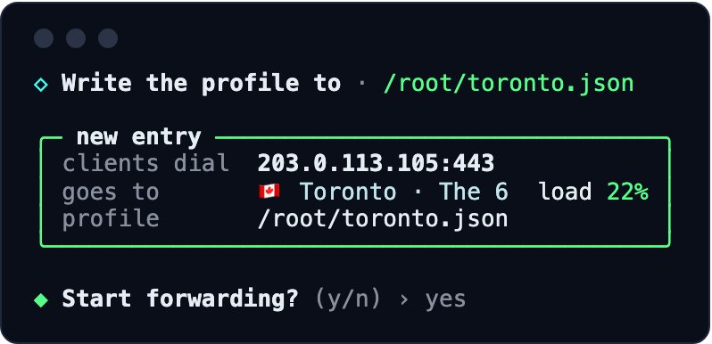
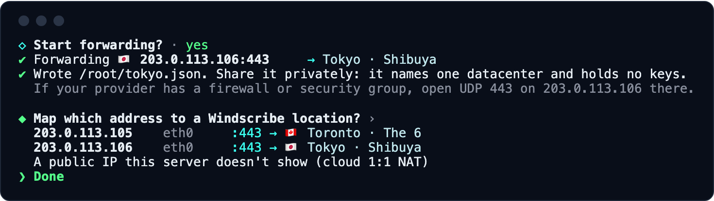
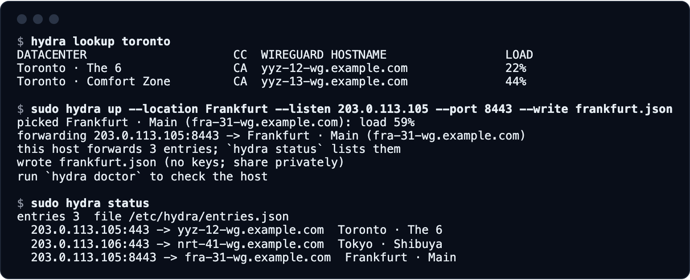
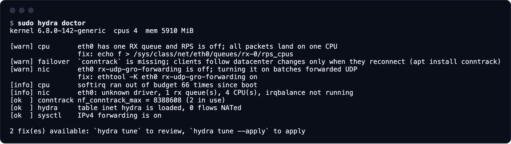

# hydra

**Your own private entry point to Windscribe.**

hydra turns a Linux server you control into a private way in to Windscribe. You share a small profile with the people you choose. Their Windscribe app connects to your server, and your server passes the encrypted traffic on to Windscribe, untouched.

```
 you / your users            your hydra server              Windscribe server           internet
 ┌───────────────┐   UDP     ┌────────────────┐    UDP     ┌──────────────────┐
 │ Windscribe app│ ────────> │ hydra          │ ─────────> │ WireGuard server │ ───────> sites
 │ + hydra       │ encrypted │ forwards bytes │ encrypted  │ decrypts, exits  │
 │   profile     │           │ unchanged      │            │                  │
 └───────────────┘           └────────────────┘            └──────────────────┘
```

**Contents:** [Why use it](#why-use-it) · [Quick start](#quick-start) · [Sharing the profile](#sharing-the-profile) · [More locations on one server](#more-locations-on-one-server) · [Privacy](#privacy) · [How it works](#how-it-works) · [Checking and tuning](#checking-and-tuning-the-server) · [Commands](#commands) · [Troubleshooting](#troubleshooting) · [Uninstall](#uninstall)

## Why use it

### Reach Windscribe where VPN servers are blocked

Some networks and countries block VPN servers by IP address. Public VPN addresses are easy to collect, so they get blocked fast.

A hydra server's address is yours:

- It isn't on any public list.
- You share it only with people you trust, for example in a private chat.
- If it gets blocked anyway, start hydra on a new server and share the new profile. It takes a few minutes.

### Split who knows what

With a normal VPN, one server is in a position to see both your real IP address and where your traffic goes. hydra puts a hop in front of it, run by you or someone you trust:

- **Your hydra server** sees your real IP address, but not the sites you visit: the tunnel stays encrypted between the app and Windscribe.
- **The Windscribe server** sees only the hydra server's address, never yours.

It works like the first two relays of Tor, but much simpler. It isn't anonymous in the Tor sense, and it's only as private as the people who run each hop. Read [Privacy](#privacy) before you rely on it.

### Simple to run

- Any VPS or home server with Linux and a public IPv4 address.
- No accounts, keys, or VPN credentials on the server.
- One binary. No daemon, no database. `hydra down` removes everything it added.
- Built-in checks and tuning for high throughput.

## Quick start

### What you need

- A Linux server with a public IPv4 address. Any small VPS works.
- Root access.
- `nftables`: `apt install nftables` or `dnf install nftables`.
- Recommended: `conntrack` (`apt install conntrack`), so connected apps follow Windscribe's changes without reconnecting.
- The UDP port you'll use (443 by default) open in your provider's firewall.

### 1. Install

Build it with a recent [Rust toolchain](https://rustup.rs):

```bash
git clone https://github.com/Windscribe/hydra.git
cd hydra
cargo build --release
sudo install -m 0755 target/release/hydra /usr/local/bin/hydra
```

### 2. Run the guided setup

```bash
sudo hydra setup
```



Setup checks the server, then walks you through four steps:

1. **Pick an address** on the server, and a UDP port (443 by default).
2. **Pick a Windscribe location**, then one of its datacenters. The least loaded comes first, or search by name.
3. **Confirm.** hydra starts forwarding and writes the profile to share.
4. **Keep it running.** Setup offers to install hydra's systemd units. Say yes: they restart forwarding after a reboot and follow Windscribe's changes every minute.





After each mapping you're back at the address list, with the next free address selected. Mapping several addresses to different locations takes one pass.



> [!TIP]
> Have an address for every Windscribe location, or a whole range such as a /24? Setup offers to map them all at once, and writes one profile that covers every location. See [More locations on one server](#more-locations-on-one-server).

| Key | What it does |
| --- | --- |
| ↑ ↓ | Move |
| Enter | Pick |
| Esc | Go back |
| Ctrl-C | Stop, without changing anything further |

Run `sudo hydra setup` (or just `sudo hydra`) again any time to:

- add or remove entries,
- write the profile again,
- check the server,
- install the systemd units, if you skipped them.

Setup draws in Windscribe's colours, with each location's flag where the terminal can show emoji (a UTF-8 locale) and its country code elsewhere. `NO_COLOR=1` turns the colours off. `HYDRA_EMOJI=0` or `1` turns the flags off or on.

### 3. Share the profile

See [Sharing the profile](#sharing-the-profile), next.

## Sharing the profile

Send the profile file (for example `toronto.json`) to the people who should use it, in a private channel. It holds only your server's address and the datacenter's name: no keys, no passwords, no server addresses.

Each person then:

1. Signs in to their Windscribe app with their own account.
2. Imports the profile: **Preferences → Connection → Hydra profile**.
3. **Selects the location the profile maps.** The app lists it under the imported profile.

> [!IMPORTANT]
> Only the locations a profile maps go through your hydra server. Every other location connects to Windscribe directly, as before. Connecting to a mapped location goes through your server automatically, over WireGuard.

The app never falls back to a direct connection for a mapped location. If your server is down, the app says it can't reach your hydra server.

## Setting up with commands

Prefer commands to the guided setup? These steps do the same.

1. **Check the server.**

   ```bash
   sudo hydra doctor
   ```

   Fix anything marked `FAIL`. `sudo hydra tune --apply` fixes most `warn` items for you.

2. **Find a location and start forwarding.**

   ```bash
   hydra lookup Toronto
   sudo hydra up --location Toronto
   ```

   hydra picks the least-loaded Toronto datacenter, starts forwarding, and writes `hydra.json` in the current directory.

   On a cloud server whose public IP isn't on the machine itself (AWS, GCP, Azure, Oracle and others), add `--listen <public IP>`.

3. **Share `hydra.json`**, as in [Sharing the profile](#sharing-the-profile).

4. **Keep it running after a reboot.** hydra saves each entry in `/etc/hydra/entries.json`, but forwarding rules don't survive a reboot on their own. Install the systemd units:

   ```bash
   sudo cp contrib/hydra.service contrib/hydra-refresh.service contrib/hydra-refresh.timer /etc/systemd/system/
   sudo systemctl daemon-reload
   sudo systemctl enable --now hydra hydra-refresh.timer
   ```

   - `hydra.service` forwards the saved entries at boot (`hydra apply`) and re-applies the host tuning.
   - `hydra-refresh.timer` follows Windscribe's changes to each datacenter every minute (`hydra apply --refresh`).

   Without systemd, run `hydra apply` at boot and `hydra apply --refresh` every minute some other way.

Here is the same for Frankfurt, on a server that already forwards two entries:



To stop: `sudo systemctl disable --now hydra`, or `sudo hydra down` without systemd. Both keep the saved entries. `sudo hydra down --forget` deletes them.

## More locations on one server

### Several entries

An **entry** is one address and port that forwards to one Windscribe datacenter. A server can run many, on different ports, different addresses, or both:

```bash
sudo hydra up --location Toronto   --port 443  --write toronto.json
sudo hydra up --location Frankfurt --port 8443 --write frankfurt.json
sudo hydra up --location London    --listen 203.0.113.6 --write london.json
```

Each `hydra up` adds an entry, or replaces the one on the same address and port. The others keep running.

| To… | Run |
| --- | --- |
| List the entries | `sudo hydra status` |
| Write one profile with every entry | `sudo hydra export > hydra.json` |
| Write one entry's profile | `sudo hydra export --entry 203.0.113.6:443` |
| Remove one entry, keep the others | `sudo hydra down --entry 203.0.113.6:443` |

Share the profile with every entry: the app holds one profile at a time, and lists its locations to pick from.

On cloud servers with 1:1 NAT, give each entry its own pair: `--listen <public IP> --bind <its private IP>`.

### Every location at once

If the server has a free public address for every Windscribe location, or a range with that many free addresses, `sudo hydra setup` offers to map them all in one step: one address each, on port 443. Its profile covers every location, and the app shows it as "All locations".

### Address ranges

A server can carry a whole range of addresses. It shows on the interface as one address with a prefix, such as `inet 198.51.100.0/24`. hydra lists ranges from /22 to /30 and can use any free address in them.

Providers hand over a range in one of two ways:

| The range is… | What hydra does |
| --- | --- |
| **Routed to your server.** The provider sends all of its traffic to you. | Uses the addresses as they are. Nothing changes on the interface. |
| **On your server's network.** The provider's router asks which machine holds each address. | Adds each address it maps to the interface (as a `/32`). Removes it when the entry is removed or forwarding stops. `hydra apply` adds it back at boot. |

`hydra setup` works out which one you have:

1. It asks once whether the range is yours.
2. It checks how the range reaches the server: it connects to Windscribe from a free address of the range, and sees whether the reply arrives.
3. It remembers the answer for that range.

If the range holds the server's gateway, it's the network the server sits on. Setup asks before adding addresses there, and skips the check. If the check can't run, setup asks you which kind of range it is.

By hand:

```bash
sudo hydra check-range 198.51.100.0/24                                  # routed here, or not?
sudo hydra up --location Toronto --listen 198.51.100.7                  # a routed range
sudo hydra up --location Toronto --listen 198.51.100.7 --add-address    # a range on the server's network
```

> [!WARNING]
> Only use a range your provider assigned to your server. Holding an address that belongs to someone else on a shared network takes it from them.

## Privacy

This section is about what each party is **technically able to see** on the network. That's different from what anyone actually looks at or keeps:

- Windscribe doesn't log your source IP, the sites you visit, or a history of your VPN sessions. See the [Windscribe privacy policy](https://windscribe.com/privacy).
- hydra itself logs nothing. What a hydra server's operator logs is up to them.

| | Your real IP address | Who you are (account) | Which Windscribe datacenter you use | Where your traffic goes |
| --- | --- | --- | --- | --- |
| hydra server | can see | cannot see | can see | cannot see (encrypted) |
| Windscribe VPN server | cannot see (sees the hydra IP) | cannot see (sees only an anonymous WireGuard key) | n/a | technically can see, not inspected or logged |
| Your local network or ISP | can see | cannot see | cannot see (sees the hydra IP) | cannot see (encrypted) |

What the columns mean:

- **Who you are:** neither server receives your username, email, or other account details. The VPN server identifies a connection only by its WireGuard public key. It uses the key to accept or reject the connection and apply your settings, and keeps it in memory for the life of the connection.
- **Where your traffic goes:** the VPN server is where your traffic leaves the tunnel for the internet, so it's the one point that could see destinations. That's true of every VPN. Without hydra, that same server could also see your real IP address. With hydra, it can't.

Good to know:

- **Your app still talks to the Windscribe API directly.** Signing in, downloading the server list, and requesting WireGuard settings go over the normal Windscribe API, from your real IP address, outside the hydra hop. hydra keeps your IP away from the VPN server your traffic flows through, not from the API you sign in to.
- **The hydra server knows which Windscribe datacenter you use**, because it forwards to it. That usually reveals the country or city your traffic exits from.
- **The two hops can be linked** by someone who can watch both of them (by timing and traffic volume), or by someone who runs both. Run your own hydra server, or use one run by someone you trust.
- **No silent fallback.** While a profile is imported, the app reaches a location the profile maps only through the hydra server. If the server is down, the app stops and says so, instead of connecting directly.

## How it works

`hydra up` creates one nftables table, `inet hydra`, and nothing else:

- **DNAT:** UDP arriving at your entry address and port goes on to the Windscribe datacenter the entry names.
- **SNAT:** it leaves with your server's address as its source, so replies come back through hydra.
- **Forward accept:** the flow is allowed through.
- **Flowtable:** established flows take the kernel's fast path. If the kernel can't, hydra uses the normal path and prints a warning.

What follows from that:

- **hydra never decrypts or changes packets.** WireGuard encryption and AmneziaWG obfuscation stay between the app and Windscribe, so hydra needs no keys or protocol settings.
- **One entry, one datacenter.** hydra can't read the encrypted traffic to choose a destination, so each entry forwards to one Windscribe datacenter, not to a whole country.
- **It keeps up with Windscribe.** `hydra apply --refresh`, every minute from the timer, picks up Windscribe's changes to each datacenter. With `conntrack` installed, connected apps carry on without reconnecting. If the check fails, hydra keeps forwarding as before.
- **Entries stay separate.** Each entry's traffic leaves for Windscribe from the address it arrived on.

## Checking and tuning the server

### `hydra doctor`

Read-only. It checks:

- **Forwarding:** IPv4 forwarding is on.
- **Connection tracking:** table size, how full it is, drops, and UDP timeouts. Each client uses one entry, and a timeout that's too short makes idle tunnels reconnect.
- **CPU:** packet backlog size, softirq budget, and drops.
- **Network card** (on the default route, or `--iface`): MTU, queues, ring sizes, GRO and UDP GRO forwarding, and RPS when the card has a single queue.
- **Other firewalls:** chains that drop forwarded traffic, for example from Docker or ufw. A rule in hydra can't override them, so doctor tells you what to allow.
- **hydra itself:** whether the table and fast path are loaded, and how many flows it has forwarded.



It exits with code 2 if any check fails. `--json` prints the same data as JSON.

### `hydra tune`

Turns doctor's findings into changes:

```bash
sudo hydra tune                     # show what would change
sudo hydra tune --apply             # apply sysctl and RPS changes now
sudo hydra tune --apply --persist   # also save sysctl changes to /etc/sysctl.d/90-hydra.conf
sudo hydra tune --apply --nic       # also change network card settings with ethtool
```

- Numeric settings are only raised, never lowered below a value you set higher.
- Offloads are only turned on.
- Network card changes need `--nic`, because some drivers briefly drop the link when queues or rings change.
- RPS and network card settings don't survive a reboot. `hydra.service` re-applies `tune --apply` (sysctl and RPS) at boot. To re-apply network card changes too, add `--nic` to its `ExecStartPost` line.

## Commands

| Command | What it does |
| --- | --- |
| `hydra setup` | Guided: add, remove and share entries, check the server, keep hydra running after a reboot. `hydra` on its own in a terminal starts it |
| `hydra lookup <query>` | Search Windscribe datacenters by city, country, or name, with their load |
| `hydra up` | Add an entry (or replace the one on the same address and port), start forwarding, and write its profile |
| `hydra apply` | Forward every saved entry again, for example at boot |
| `hydra down` | Stop forwarding and keep the saved entries. `--entry IP:PORT` removes one entry and keeps the others running; `--forget` deletes them all |
| `hydra export` | Print the profile to share: one for all entries, or one entry's with `--entry IP:PORT` |
| `hydra status` | List the entries this server forwards |
| `hydra check-range <CIDR>` | Check whether one of the server's address ranges is routed to it, or needs `--add-address` ([Address ranges](#address-ranges)) |
| `hydra doctor` | Check the server (read-only) |
| `hydra tune` | Show or apply recommended host settings |
| `hydra version` | Print the version |

### `hydra up` options

| Option | Meaning |
| --- | --- |
| `--location <query>` | Use the least-loaded datacenter matching this city, country, or name in Windscribe's current locations. Datacenters that aren't taking new connections are skipped unless nothing else matches |
| `--datacenter <hostname>` | Use a specific datacenter, by its WireGuard hostname (the one its WireGuard configs use) |
| `--label <text>` | How the profile names the place (default: from Windscribe's locations) |
| `--exit-port <port>` | The datacenter's UDP port (default 443) |
| `--listen <ip>` | Public IPv4 address clients connect to (default: detected) |
| `--bind <ip>` | Local address traffic arrives on, if not the same as `--listen` (default: detected) |
| `--add-address` | Hold `--listen` on the server (as a `/32`) while its entry forwards: for an address of a range that isn't routed to the server ([Address ranges](#address-ranges)) |
| `--port <port>` | UDP port clients connect to (default 443) |
| `--write <file>` | Where to write the profile (default `hydra.json`) |
| `--from <file>` | Add the entries in an existing profile instead of building a new one |
| `--state <file>` | Where the entries are saved (default `/etc/hydra/entries.json`). `apply`, `down`, `export` and `status` take it too |
| `--status-url <url>` | Where Windscribe's locations come from, for `--location` and `--datacenter` (default: Windscribe's public status endpoint). `lookup` and `setup` take it too |
| `--wg-zone <zone>` | The DNS zone of the datacenters' WireGuard hostnames (default: the one Windscribe's WireGuard configs use) |
| `--id <name>` | Name written into the profile (default: hostname) |
| `--no-flowtable` | Don't use the fast path |
| `--dry-run` | Print the rules and profile without changing anything |
| `--skip-nft` | Write the profile only |
| `--skip-sysctl` | Don't turn on IPv4 forwarding |

## The profile

```json
{
  "version": 2,
  "kind": "windscribe.hydra.profile",
  "hydra_id": "my-server",
  "created_at": "2026-10-28T19:00:00Z",
  "fronts": [
    {
      "location": "Toronto · The 6",
      "datacenter": "yyz-12-wg.example.com",
      "datacenter_id": 12,
      "exit_port": 443,
      "entry_ip": "203.0.113.5",
      "entry_port": 443,
      "protocol": "wireguard"
    }
  ]
}
```

- When the app connects to the datacenter with the id in `datacenter_id`, it uses `entry_ip:entry_port` as the WireGuard endpoint instead of Windscribe's own address.
- `datacenter` is the datacenter's WireGuard hostname, the one its WireGuard configs use. hydra forwards to it.
- Both come from Windscribe's public list of locations, which is why `hydra up --datacenter` reads it.
- Everything else, including your account, keys, and obfuscation settings, comes from the app as usual.
- A profile can list several fronts, one per location. The app shows them under the profile, and each applies only when its location is selected.
- `"all": true` (written only when true) means the fronts covered every Windscribe location when the profile was written.
- Profiles reject unknown fields, so a key pasted into one makes it invalid instead of being shared by accident.

## Troubleshooting

### The app doesn't connect through hydra

1. Check that the app is connecting to a location the profile maps. The app lists them under the imported profile; every other location connects directly.
2. Run `sudo hydra doctor` on the server. The most common causes:
   - the UDP port is closed in your provider's firewall or security group;
   - another firewall (Docker, ufw, firewalld) drops forwarded traffic, and doctor names the chain;
   - IPv4 forwarding is off;
   - the profile was made with a private address: use `--listen <public IP>`.

### The app says "Can't reach your hydra server"

The app tried the hydra entry in the profile, got no answer, and stopped without connecting directly.

- Run `sudo hydra doctor` on the server.
- To connect without hydra, remove the profile in the app (**Preferences → Connection → Hydra profile**).

### The app says "Hydra needs WireGuard"

The app's protocol is set to something other than WireGuard. Choose WireGuard or Auto, or remove the profile.

### `hydra up` says the default source isn't a public address

Your server is behind NAT. Pass its public IP with `--listen`.

### An entry on an address of a range gets no traffic

Run `sudo hydra check-range <the range>`.

- **Not routed to the server:** map the address again with `--add-address`, or remove the entry and map it again with `sudo hydra setup`.
- **Routed:** check your provider's firewall for that address.

### `hydra doctor` reports conntrack drops

Run `sudo hydra tune --apply --persist`.

### It was working and stopped

The address may be blocked on your users' network. Start hydra on a new server and share the new profile.

## Uninstall

```bash
sudo systemctl disable --now hydra hydra-refresh.timer    # if you installed the systemd units
sudo hydra down --forget                                  # stop forwarding, delete the saved entries
sudo rm -f /etc/systemd/system/hydra.service /etc/systemd/system/hydra-refresh.service /etc/systemd/system/hydra-refresh.timer
sudo rm -f /usr/local/bin/hydra /etc/sysctl.d/90-hydra.conf
```

Settings `hydra tune` changed without `--persist` go back to their defaults at the next reboot.

## Limits

- IPv4 only.
- UDP only (WireGuard and AmneziaWG). OpenVPN, IKEv2, and TCP-based protocols aren't forwarded.
- Linux with nftables only.
- No logging, rate limiting, or access control. Anyone with the profile can send traffic through your server to that Windscribe datacenter. Windscribe still requires a valid account to connect.
- Traffic through the hydra server counts against your provider's bandwidth quota, in both directions.

## Contributing

Building, tests, and the project's design rules are in [CONTRIBUTING.md](CONTRIBUTING.md).

## License

MIT. See [LICENSE](LICENSE).
